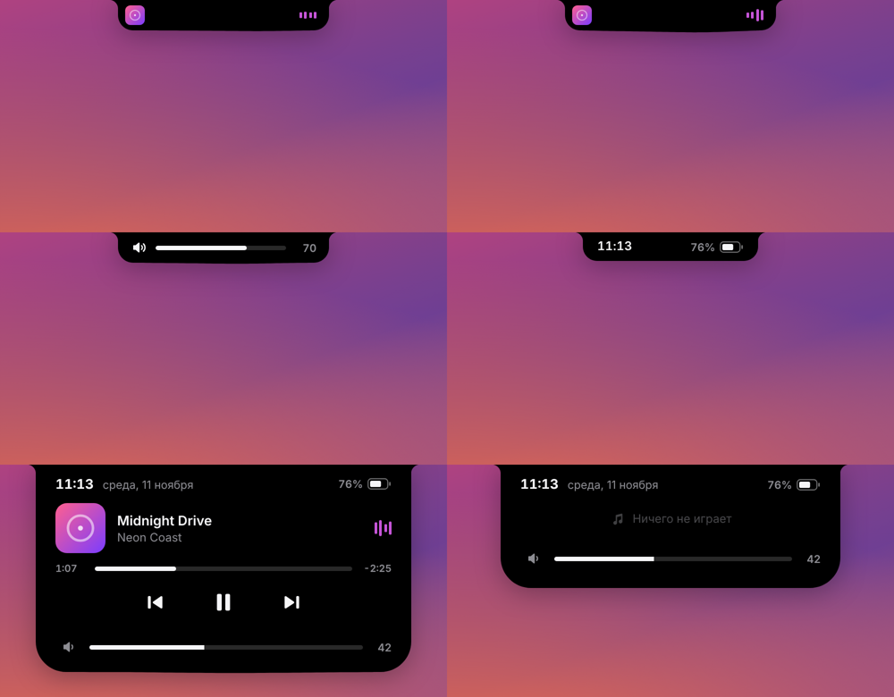
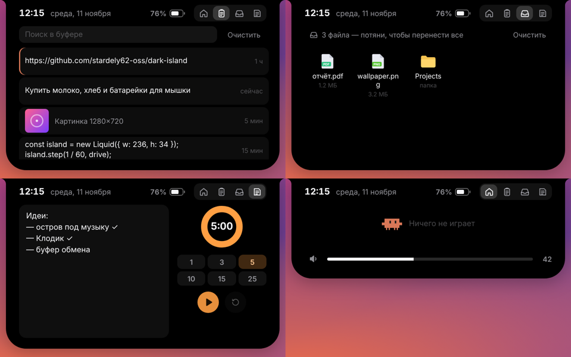
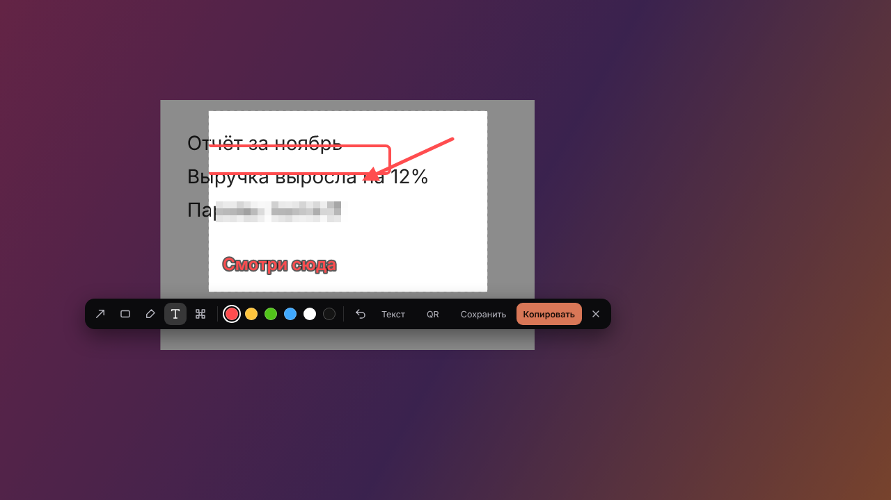
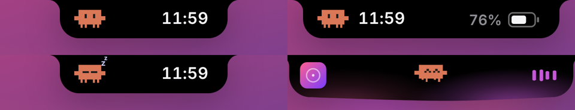
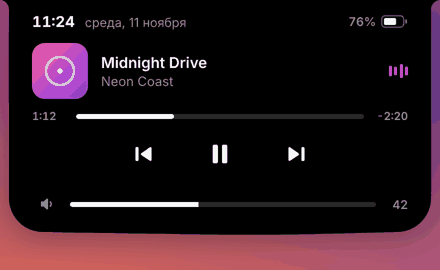

# Dark Island

Динамический остров для Windows 10/11: чёрная «живая» пилюля по центру верхнего края экрана.
Открытый код, без телеметрии и автообновлений. В сеть остров ходит только за тем, что ты
включил: прогноз для выбранного города (api.met.no), поиск города (nominatim.openstreetmap.org),
текст играющей песни (lrclib.net), страна VPN (ipwho.is), выбранный сервис ИИ и распознавания
речи — со своим ключом, сервис картинок — только по кнопке «Ссылка».

### Чего нет (пока или намеренно)

- Автообновления и платной части — их нет намеренно.
- Вход в Gemini/DeepSeek через сайт без ключа и галерея из 25 персонажей (вместо неё — Клодик).



## Что умеет (v0.1)

- **Часы**, **заряд батареи** (на ноутбуке) и **Клодик** в свёрнутом виде.
- **Музыка** из любого плеера, который сообщает о себе Windows (Spotify, Яндекс Музыка в браузере,
  YouTube, Медиаплеер…): обложка, название, прогресс, кнопки, цвет эквалайзера берётся из обложки.
- **Громкость**: колесо мыши над островом, ползунок в раскрытом виде; при смене громкости клавишами
  остров показывает индикатор.
- **Раскрывается** при наведении и сворачивается, когда курсор уходит.
- **Не мешает**: не забирает фокус, вне острова клики проходят насквозь.
- **Уступает место приложениям**: если окно заходит под остров (развёрнутый браузер с вкладками
  и адресной строкой) или приложение на весь экран (видео, F11, презентации), остров сжимается в
  тонкую линию и раскрывается, если задержать на ней курсор. В играх скрывается полностью. Игра узнаётся по эксклюзивному полноэкранному режиму, по движку окна (Unity, Unreal, SDL,
  GLFW, Source…) или по папке игры (Steam, Epic, Riot, GOG, Ubisoft, EA, Xbox, Battle.net, `\Games\`).
- **Панель со вкладками** (наведи на остров, кликни по нему или нажми `Ctrl+Alt+I`):
  - **Главная** — музыка и громкость;
  - **Буфер** — история скопированного текста и картинок с поиском и закреплением; клик вставляет
    запись прямо в окно, где ты печатал (`Ctrl+Alt+V` открывает сразу эту вкладку). Копии из
    менеджеров паролей, помеченные как приватные, не записываются;
  - **Полка** — брось файлы на остров, и они подождут, пока ты не вытащишь их в нужное окно
    (по одному или все сразу); двойной клик открывает файл, правый — показывает в папке;
  - **Заметка и таймер** — заметка сохраняется сама; таймер с готовыми отрезками (колесо мыши на
    циферблате меняет минуты), пока идёт — виден в пилюле, по окончании звенит.
  - **Управление** — Wi-Fi, Bluetooth и тёмная тема Windows одним нажатием; блокировка, сон,
    перезагрузка и выключение (последние два просят нажать дважды);
  - **Настройки** — поведение острова, агенты, буфер, поисковик.
- **Командная строка** (`Alt+Space`): программы (и из Магазина), калькулятор (`2+2*3`,
  `sqrt(16)`, `15%*200`), единицы (`5 км в милях`, `100 c to f`, `2 гб в мб`), `таймер 10 мин`,
  команды (`wifi`, `vpn`, `тема`, `заблокировать`, `сон`), поиск в интернете; строка после `>` выполняется
  в cmd, после `ps>` — в PowerShell.
- **ИИ-агенты в терминале**: Claude Code, Codex и opencode подключаются в настройках одной кнопкой. Пока
  агент работает, в пилюле печатает Клодик; когда Claude Code просит разрешение, на острове
  появляется карточка с командой и кнопками «Разрешить» / «Запретить» (30 секунд, потом вопрос
  уходит в терминал как обычно); когда закончил — карточка с началом ответа. Остров добавляет свои
  HTTP-хуки в `~/.claude/settings.json`, `notify` в `~/.codex/config.toml` и плагин
  `dark-island.js` в `~/.config/opencode/plugin`, рядом с изменёнными файлами остаётся копия
  исходного; запросы принимаются только с этого компьютера и только с ключом острова.
- **Инструменты экрана** (вкладка «Управление» или клавиши): скриншот области или всего экрана
  с разметкой — стрелка, рамка, маркер, текст, пикселизация личных данных, отмена; результат
  уходит в буфер и в папку «Изображения\Screenshots\Dark Island». **Текст с экрана** (OCR
  распознавателями Windows, русский и английский склеиваются построчно), **QR-код с экрана**,
  **пипетка** с лупой и историей цветов. По умолчанию остров не попадает на скриншоты, в запись
  экрана и на трансляции (меняется в настройках).
- **Погода** (вкладка): сейчас, 24 часа и неделя от MET Norway для города, выбранного по названию
  (не по адресу в сети); температура на свёрнутом острове; карточка примерно за час до дождя или снега.
- **Музыка**: вид пилюли — обычная, широкая (название и полоса времени), мини-плеер с кнопками,
  **текст песни** в такт (строка, которая звучит сейчас; из открытой базы LRCLIB, только для
  играющей песни) или **только слова** — одна строка в цвет обложки. Кроме плееров, которые
  сообщают о себе Windows, понимает **Winamp** и **AIMP** (название, время, кнопки).
- **Звук**: чью громкость крутит остров (любой выход) и какой микрофон выключает; переключатель
  «Компьютер / Плеер» у ползунка — громкость всей системы или только играющей программы.
- **Bluetooth**: на плитке «Управления» — список сопряжённых устройств с зарядом; наушники и
  колонки подключаются и отключаются в одно нажатие.
- **Уведомления Windows** карточкой на острове, клик открывает программу (включается в настройках,
  там же — программы, которые не показывать).
- **Микрофон и камера**: оранжевая и зелёная точки рядом с островом, пока программа ими пользуется;
  микрофон выключается плиткой на «Управлении» или `Ctrl+Alt+M`.
- **Загрузки** из любой программы в папку «Загрузки»: в пилюле — имя, размер и скорость; по
  окончании — карточка, клик показывает файл в папке. **Игры в Steam** — с процентом, пилюля
  заполняется по мере загрузки.
- **VPN**: карточка при включении и выключении, со страной и IP (один запрос к ipwho.is, отключается).
  Плитка на «Управлении», команда `vpn` и `Ctrl+Alt+P` управляют выбранной VPN-программой
  (Happ, Incy, v2rayN, Hiddify…: запускают её, а в режиме системного прокси включают и выключают
  прокси сами; в режиме TUN открывают программу), Cloudflare WARP, VPN Windows (rasdial) или
  своими командами.
- **OBS Studio**: пока идёт запись или эфир — пилюля с REC / LIVE и временем (через встроенный
  obs-websocket, только с этого компьютера; включается в настройках, пароль хранится как ключи).
- **Автоскрытие** (остров уходит и возвращается, если задержать курсор у верхнего края), **прятаться
  в выбранных программах** и **сквозной режим** (`Ctrl+Alt+T`: свёрнутый остров пропускает клики).
- **Лаунчер** на «Главной»: ярлыки программ, сайтов и папок. Перетащи ярлык на другой — будет
  **группа**; правый клик — **своё сочетание клавиш** для ярлыка, переименовать группу, вынуть
  или убрать. Клодик запрыгивает на ярлык, прежде чем программа откроется.
- **ИИ со своим ключом** (вкладка «ИИ», `Ctrl+Alt+A`): чат с картинками (вставить через Ctrl+V)
  и **документами** (скрепка: PDF, Word, Excel, PowerPoint, текст — читаются на компьютере, в чат
  уходит только текст)
  и **инструменты для текста** — не та раскладка, регистры, транслит, JSON, Base64, URL, плюс
  действия ИИ: перевести, исправить, сократить, объяснить, ответить; результат копируется или
  вставляется в окно. Вопрос можно задать и из командной строки (`Tab`). Сервисы: Claude
  (Anthropic Messages API, по умолчанию `claude-opus-5-5`, при отказе модели запрос сам уходит на
  запасную), Groq, Gemini, OpenRouter, DeepSeek, OpenAI или любой OpenAI-совместимый адрес
  (Ollama, LM Studio). Ключ шифруется Windows (DPAPI) и уходит только в свой сервис.
- **Голос в текст** (`Ctrl+Alt+D`): запись с микрофона, распознавание Whisper (Groq или OpenAI),
  текст в буфер и сразу в окно, где стоял курсор.
- **Запись экрана** (`Ctrl+Alt+R`): область или весь экран в MP4 (H.264 и AAC, Media Foundation),
  30 или 60 кадров, с курсором и со звуком компьютера или микрофона — или в **GIF**; в пилюле —
  красная точка и время, клик останавливает.
- **Перевод с экрана**: после «Текста с экрана» у карточки есть кнопка «Перевести» — текст
  открывается в инструментах ИИ и сразу переводится.
- **Ссылка на скриншот**: кнопка «Ссылка» загружает снимок на ImgBB или Imgur со своим ключом.
- **Напоминания одной фразой** («позвонить маме завтра в 9», «таблетки каждый день в 23:00»,
  «через 20 минут выключить плиту»): на вкладке «Заметка» или `напомни …` в командной строке;
  приходят карточкой со звуком, можно отложить на 10 минут.
- **Вставка без форматирования** (`Ctrl+Alt+Shift+V`).
- **Вид**: тёмная, светлая или как в Windows тема острова; размер 80–200 %; прозрачность
  свёрнутого и открытого отдельно; монитор и сдвиг вдоль верхнего края; с панелью задач сверху
  остров встаёт под неё.
- **Карточки событий**: Caps Lock, смена раскладки, таймер, напоминания, агенты, снимки,
  загрузки, VPN, уведомления.
- **Автозапуск** и выход — в меню значка в трее.



### Горячие клавиши

| | |
|---|---|
| `Ctrl+Alt+I` | открыть или закрыть остров |
| `Ctrl+Alt+V` | история буфера |
| `Alt+Space` | командная строка |
| `Ctrl+Alt+S` / `Ctrl+Alt+Shift+S` | скриншот области / экрана |
| `Ctrl+Alt+O` | текст с экрана |
| `Ctrl+Alt+Q` | QR-код с экрана |
| `Ctrl+Alt+C` | пипетка |
| `Ctrl+Alt+M` | микрофон: выключить и включить |
| `Ctrl+Alt+T` | сквозной режим |
| `Ctrl+Alt+A` | чат с ИИ |
| `Ctrl+Alt+D` | голос в текст: начать и закончить |
| `Ctrl+Alt+R` | запись экрана: начать и остановить |
| `Ctrl+Alt+Shift+V` | вставить без форматирования |
| `Ctrl+Alt+P` | VPN: включить и выключить |



Открытый кликом или клавишей остров закрывается кликом мимо него.

### Клодик



Маленький пиксельный компаньон в духе маскота Claude Code: терракотовое тельце, глаза-столбики,
ручки и четыре ножки. Дышит и моргает, следит глазами за курсором, когда тот рядом, танцует под
музыку (переминается с ножки на ножку, подпрыгивает на бит и радостно щурится) и засыпает, если
пару минут не трогать клавиатуру и мышь.
Код — [`src/components/Buddy.tsx`](src/components/Buddy.tsx).

### Жидкий край

Нижний край — цепочка связанных пружин. Он тянется к курсору, пружинит, когда остров меняет
размер, и двигается под музыку: остров слушает звук системы (WASAPI loopback, только громкость
шести частотных полос, сам звук никуда не уходит). Бас мягко прогибает край и чуть расширяет
остров, средние и высокие частоты идут длинными медленными волнами, эквалайзер в пилюле
показывает те же уровни. Ещё под музыку:

- **свет в цвет обложки**: внутри у нижнего края, как в лава-лампе, плавают три мягких пятна
  (бас, середина, верха), каждое разгорается от своей части звука; под островом дышит ореол;
- **бит**: на сильной доле остров мягко пружинит, по краю пробегает плавная волна;
- **капли**: изредка на сильной доле на краю набухает капля, тянется на шейке, отрывается и тает. Уровни сглаживаются как у VU-метра (быстро вверх, плавно вниз), а
пружины края фильтруют их ещё раз.


 В отличие от «шипов» у других реализаций, здесь всё
гладкое: сильное натяжение между соседними точками не даёт образоваться пикам, силы задаются
широкими кривыми, а край рисуется сплайном. Анимация останавливается, когда ничего не происходит.
Код — [`src/liquid.ts`](src/liquid.ts).

## Установка

Готовые сборки — во вкладке **Actions** → последний запуск **Build** → артефакт
`dark-island-windows` (установщик `*-setup.exe` и портативный `dark-island.exe`).
Сборки не подписаны, поэтому SmartScreen может предупредить: «Подробнее» → «Выполнить в любом случае».

## Разработка

Нужны Node.js 22+ и Rust (stable), на Windows — WebView2 (есть в Windows 11).

```bash
npm install
npx tauri dev       # запустить остров
npx tauri build     # собрать установщик
npm run dev         # только интерфейс в браузере, с тестовыми данными
```

В браузере (`npm run dev`, http://localhost:1420) вместо Windows работает заглушка: можно
отлаживать вид и анимации на любой ОС. `?nomedia` и `?nobattery` в адресе убирают музыку и батарею.

### Устройство

| Часть | Где |
|---|---|
| Окно, трей, команды | `src-tauri/src/lib.rs` |
| Курсор и сквозные клики | `src-tauri/src/cursor.rs` |
| Музыка (GSMTC), громкость (WASAPI), батарея, полноэкранный режим | `src-tauri/src/sys/windows.rs` |
| Анализ звука для анимации (loopback + FFT) | `src-tauri/src/sys/meter.rs` |
| Интерфейс и состояния | `src/App.tsx` |
| Физика жидкого края | `src/liquid.ts` |
| Вкладки панели | `src/panels/` |
| Буфер, полка, заметка (хранение) | `src-tauri/src/clip.rs` |
| Claude Code и Codex | `src-tauri/src/agents.rs` |
| Скриншоты, OCR, QR, пипетка | `src-tauri/src/capture.rs`, `src/overlay/` |
| Погода, тексты песен, загрузки, VPN | `src-tauri/src/live.rs` |
| ИИ, ключи, распознавание речи, загрузка картинок | `src-tauri/src/ai.rs` |
| Запись микрофона и экрана | `src-tauri/src/sys/record.rs` |
| Настройки | `src-tauri/src/settings.rs`, `src/settings.ts` |
| Связь с Rust и заглушка для браузера | `src/ipc.ts` |

Окно прозрачное, 640×300, всегда сверху. Интерфейс сообщает Rust прямоугольник острова, и Rust
включает приём мыши только когда курсор над ним.
